# Chronicle

Chronicle keeps a journal of your account: loot, levels, kill counts, the collection log, slayer, clues, quests, diaries, combat achievements and more.

Everything is stored on your computer as plain JSON in `.runelite/chronicle/`. Every number in the panel is worked out from those files, the game and the reference tables bundled with the plugin.

## Using Chronicle

The side panel has four tabs: Record, Standing, Loot and Trackers. The bar above the tabs sets the period the boards show, from the current session to lifetime. Now always shows the current session. On the other boards, click the bar to pick a year, month, week, day or exact dates, and use the arrows on either side to step back and forward. The search box below the tabs searches everything.

The boards update live. A drop, level, kill or clue shows up on the board you are looking at as soon as it happens.

### Record

  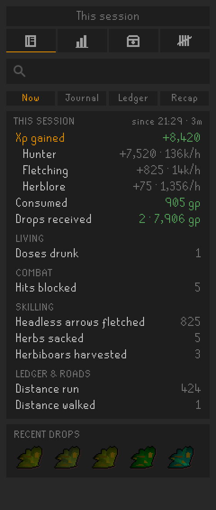
  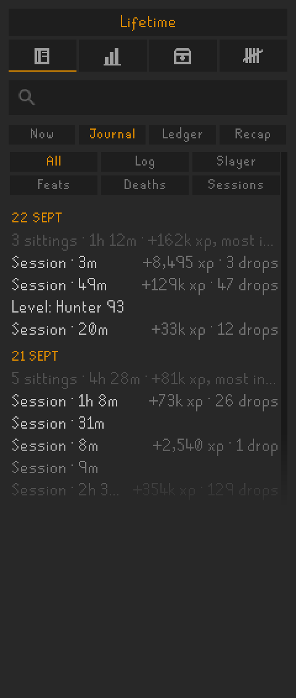
  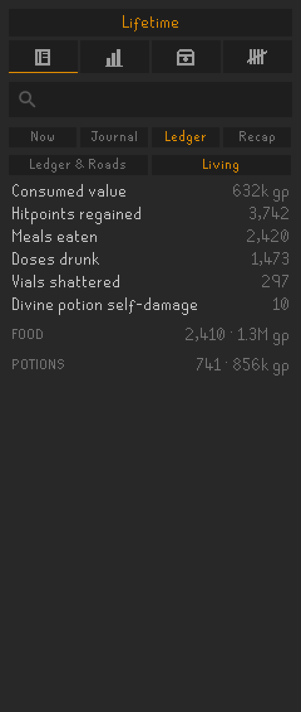
  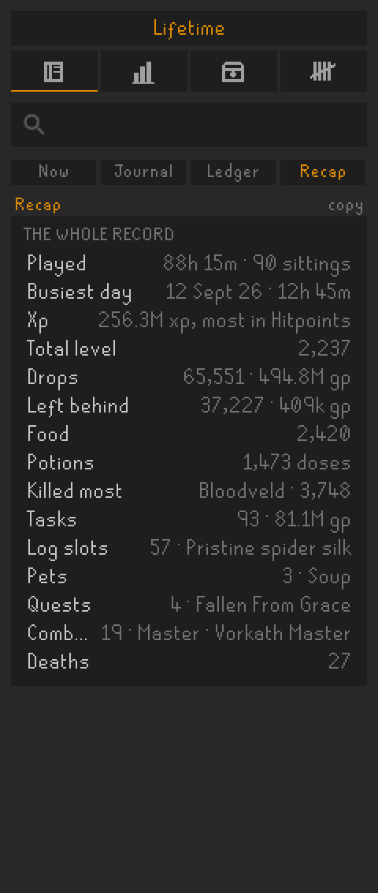

**Now** is your current session: xp gained, drops and their value, and anything else the session produced. Only what happened is listed, so a short session has a short page. Click the xp to see each skill and its xp per hour. Your slayer task appears at the top once you start killing it, and your latest drops are along the bottom. The red X on the This session bar saves this session to the journal and starts a fresh one without logging out, so you can time a run between banks.

**Journal** is a dated feed of every session, level, pet, collection log slot, quest, diary, combat achievement, slayer task, clue, personal best and death (with what killed you), grouped by day and filterable by type. Each day starts with its time played, xp and drops. It also marks milestones the game does not announce, such as 2,000 total level or 50M xp in a skill. Days recorded, on the journal's title card, opens a calendar of every day you have played.

**Ledger** has the trackers that are not kills, skills or combat, on two boards. Ledger & Roads has coins in and out, distance travelled, teleports and other odds and ends. Living has what you ate and drank, and what it cost.

**Recap** sums up the period on one card: time played, xp, drops, food and potions, most killed monsters, slayer tasks, log slots, pets, quests, diaries, combat achievements and deaths. Each line opens its board. Copy puts the whole period on your clipboard as one picture: every skill and boss at the start and end of the period, the monsters you killed most, the loot, the trackers and what you achieved.

### Standing

  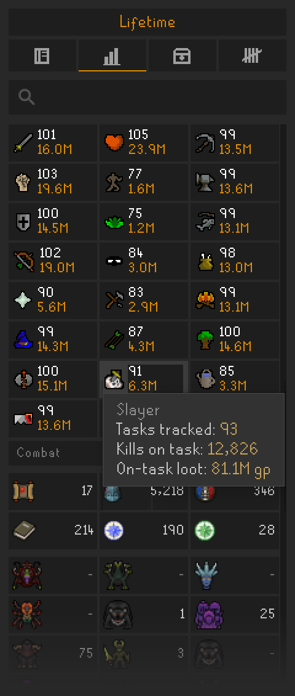
  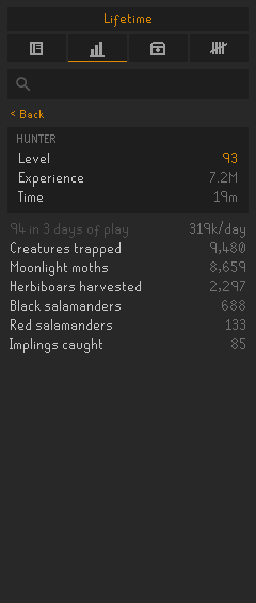
  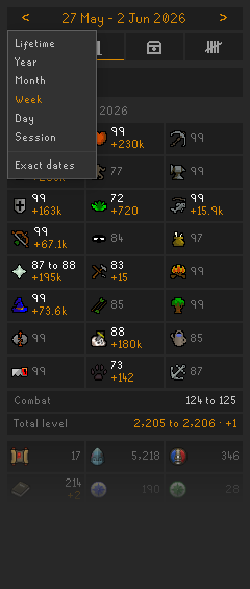

One sheet in the same order as the game's hiscores: skills, combat and total level, activities, then bosses. Each skill shows its level and how much it moved in the period, and opens a page for that skill with its pace and counters, such as logs chopped by tree or runes crafted by type. Boss cells show your kill count. Hover any cell for more. For shorter periods the sheet shows only what changed, and only the bosses you killed.

Your total level opens your records: longest session, biggest day, most kills in a day, richest day and highest hit.

The activity tiles open the rest of your account. Clues shows each tier and what it paid. Quests shows where each quest stands. Achievement diaries open by region, and your combat level opens the combat achievements by monster. Each task shows what it needs. Collections opens the whole collection log, or for a shorter period, the slots logged in it.

The collection log uses the game's five tabs and shows your completion, the slots you hold, and the kill count where the log gives one. Click a page to see every slot on it, held or missing, with dates where known. Opening the log in game once records every slot on every page, and a page's kill count is recorded when you view that page.

### Loot

  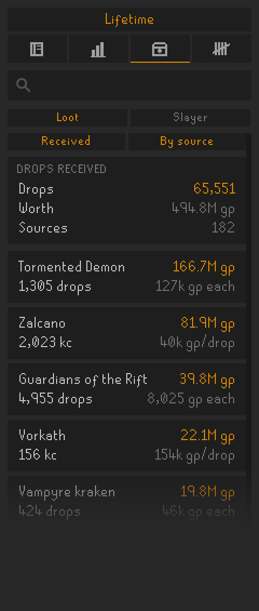
  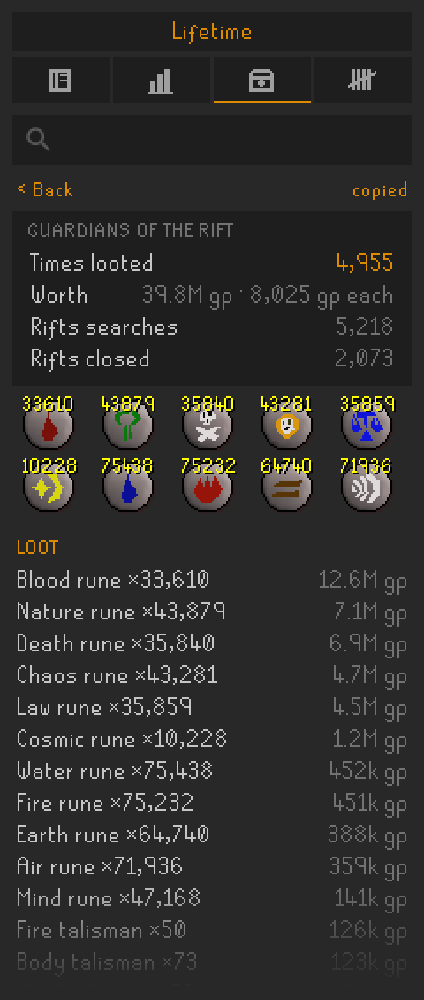
  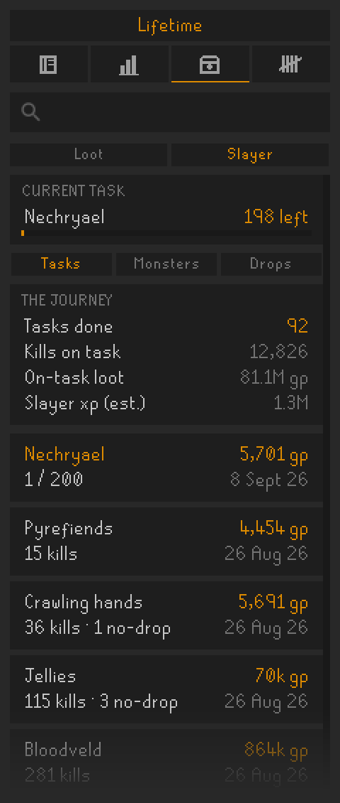
  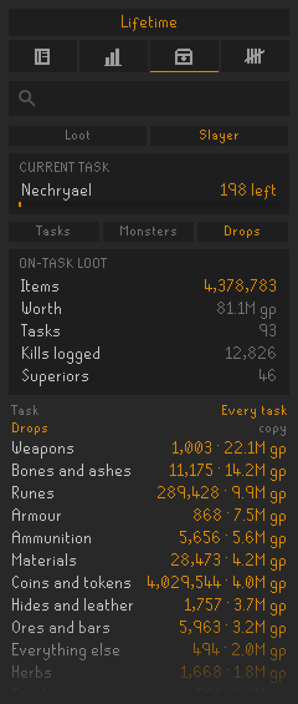

**Loot** lists every source and every item, as received or left behind, by source or by item, with values. Received loot can also be grouped by item type and narrowed to what your slayer tasks paid. A source opens to its kill count, value per drop, your personal best and when you set it, your average kill time, the time you have spent there, and every item it has dropped. An item opens to when it first and last dropped, and where from. For shorter periods both pages show only that period's loot. Either page can be copied as a picture.

**Slayer** keeps your current task at the top, over three boards: your task history with what each task paid and how many kills dropped nothing, the game's kill count per monster, and the drops from your tasks. A task opens to the monsters you killed on it and what it paid, next to your average and best for that task.

### Trackers

Every counter Chronicle keeps, grouped by type. Combat has damage dealt and taken, your highest hits and your deaths, which open to what killed you. Skilling has what each skill has done, such as fish caught by type or laps run by course. Living and Ledger & Roads are the two boards also shown under Ledger. The link under the groups opens every tracker on one page.

### Search

  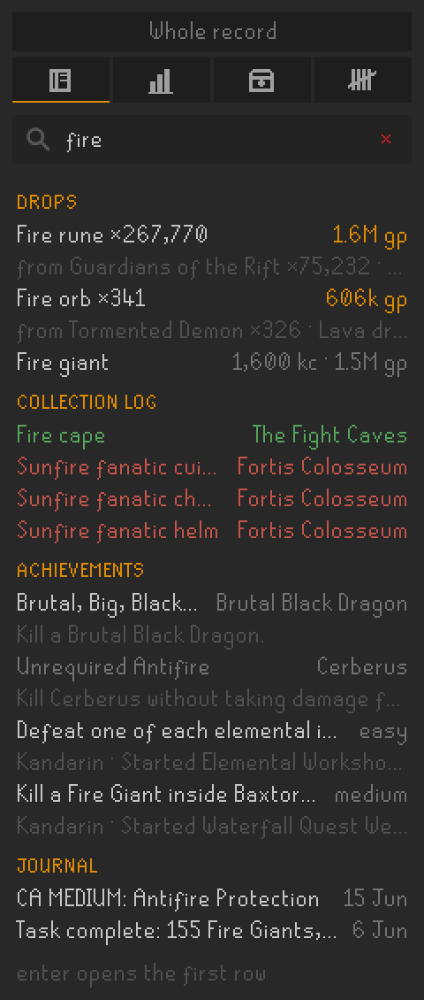

The search box searches everything as you type: skills and pages, bosses and monsters, slayer tasks, items, the collection log, quests, combat achievements and diary tasks, trackers and journal entries. The best match comes first and Enter opens it. If nothing matches, it suggests the closest name it knows.

## Dependencies

Some features rely on two of RuneLite's built-in plugins, Slayer and Loot Tracker. Chronicle declares Slayer, so RuneLite loads it with Chronicle. Loot Tracker has to be turned on in RuneLite. If either is off, a bar under the search box says so, and clicking it turns the plugin back on.

**Slayer** lets Chronicle tag kills as on task, so you can see your tasks and their loot.

**Loot Tracker** is how chests, caskets and other loot that is not an NPC drop reach Chronicle. Its saved history is imported on first run, so a new install starts with the drops already on your disk.

## Backups

The journal is plain files, so copying `.runelite/chronicle/` is a backup, and copying it back with RuneLite closed restores it. To add a journal from another computer, log in, tick Import a journal in the Advanced settings and choose the file. Importing the same file twice changes nothing.

## Sync

Cloud sync is in the Advanced settings. It is off by default and needs a server address and a token from that server. When it is on, it sends your account's activity as you play: each drop, level, task and log slot as it happens, and your counters and levels every few minutes. Nothing is read back. You can run your own server and use the data however you like, for example with a Discord bot that answers questions about your account. The requests are in [ChronicleApiClient.java](src/main/java/chronicle/ChronicleApiClient.java), and the events they send are built in [ChronicleEventCapture.java](src/main/java/chronicle/ChronicleEventCapture.java).

## Licence

BSD 2-Clause, see [LICENSE](LICENSE). Not affiliated with Jagex or RuneLite.
